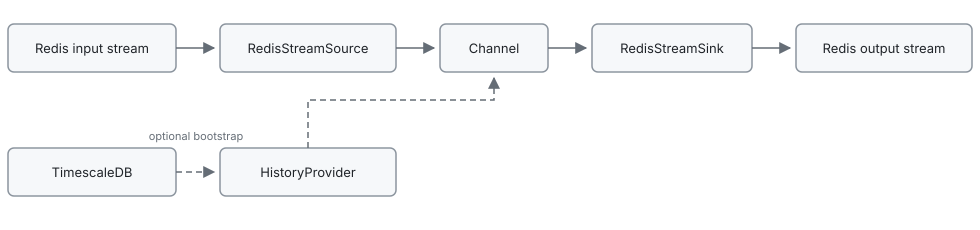
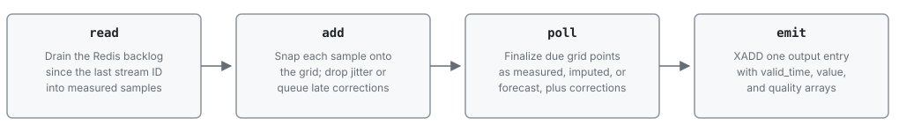

# RDP Regularizer

Measurement streams from the data crawler arrive on Redis with jittery timestamps and gaps. This service reads those streams, snaps samples onto a UTC grid `epoch + k * update_interval` (epoch is 1970-01-01), fills missing steps by imputation or forecast, and writes a strictly regular output stream that downstream consumers can unpack. Each configured channel runs in its own worker thread. Optional TimescaleDB history can bootstrap the in-memory window at startup so the grid does not start empty.

Requires Python `>=3.10`.

## How it works

[`TimeGridRegularizer`](regularizer/regularizer.py) advances a monotonic frontier. Each grid point is finalized once, in order, as **measured**, **imputed**, or **forecast**. Late measured values may re-emit corrections that upgrade imputed/forecast points still held in the in-memory window; the frontier does not rewind.

- Incoming samples snap to the nearest grid point when `|timestamp - grid| <= jitter_tolerance` (default `0.5 * update_interval`). If several samples map to the same point, the closest wins; farther ones are dropped.
- **measured** — a snapped sample is pending for that grid point.
- **imputed** — an interior gap: later measured data is already pending. The `default` imputer is last observation carried forward, then next observation, through the last known value (trailing holes stay empty).
- **forecast** — no data by the deadline `grid_time + lag_time`. The `default` forecaster repeats the last history value (else NaN).
- Optional TimescaleDB bootstrap replays raw history into that window and publishes it to the output stream before live polling starts.

## Architecture

Each poll tick drains the Redis backlog, regularizes onto the grid, and writes one output entry.



Each scheduled tick runs `Channel._step`:



Polling is aligned to `epoch + k * polling_interval + offset`. `update_interval` has to divide both `polling_interval` and `lag_time`; see [Update interval, polling interval and lag time](#update-interval-polling-interval-and-lag-time).

## Package layout

| Path | Role |
|------|------|
| [`regularizer/__main__.py`](regularizer/__main__.py) | CLI: load config, start channel threads |
| [`regularizer/channel.py`](regularizer/channel.py) | Per-channel scheduler and I/O wiring |
| [`regularizer/regularizer.py`](regularizer/regularizer.py) | Time-grid regularization and late corrections |
| [`regularizer/config.py`](regularizer/config.py) | `ChannelConfig` / `HistoryProviderConfig` |
| [`regularizer/io/`](regularizer/io/) | Redis stream source and sink |
| [`regularizer/history/`](regularizer/history/) | Timescale fetch and in-memory history store |
| [`regularizer/tools/`](regularizer/tools/) | Imputer and forecaster registries |

## Configuration

The process loads YAML through `pyrdp_commons.cli.setup_app`. Paths can be set on the CLI or via environment variables:

| Option | Env var | Default | Role |
|--------|---------|---------|------|
| `-c` / `--config` | `REGULARIZER_CONFIG` | `config.yml` | YAML config file |
| `--env` | `REGULARIZER_ENV` | unset | optional dotenv file for `!env-template` substitution |

YAML values may use `!env-template "${VAR}"` (see [`docker/etc/regularizer/config.yml`](docker/etc/regularizer/config.yml)). A full example is in [`docs/config.md`](docs/config.md).

**Durations** (`ms`, `s`, `m`, `h`, `d`, `w`, e.g. `30s`, `1m`); bare numbers are seconds.

| Section | Keys |
|---------|------|
| `redis` | `host`, `port`, `db`, optional `password` |
| `timescale` | `host`, `port`, `db`, `user`, `password` — required if any channel has `history_provider` |
| `channels.<name>` | required: `input_stream`, `output_stream`, `polling_interval`, `update_interval`, `window` |
| | optional: `jitter_tolerance`, `offset`, `lag_time`, `output_maxlen` (200), `data_provider_name` (`rdp-regularizer`), `imputer` / `forecaster` (`default`; string name or mapping `{name, ...}`) |
| `history_provider` | omit or `null` to skip bootstrap; else `dp_name` plus optional `dp_location_code`, `dp_unit`, `dp_data_provider`, `dp_device_id`, `init_when_source_available`, `bootstrap_delay` (default `10s`) |

### Update interval, polling interval and lag time

The regularizer works with two sets of timestamps:

- **Sample grid.** Each incoming sample is assigned to the nearest point `epoch + k * update_interval`, provided it lies within `jitter_tolerance` of that point.
- **Frontier.** The frontier is the next grid point to be finalized. At startup it is set to `floor(start_time, polling_interval) - lag_time`. After that it advances in steps of `update_interval`.

A grid point is finalized as **measured** only if the frontier timestamp is identical to the timestamp of a snapped sample. The frontier therefore has to start on the sample grid. Because it then advances by `update_interval`, it stays on that grid. The start point is on the sample grid if both of these hold:

- `update_interval` divides `polling_interval`, and
- `update_interval` divides `lag_time`.

If either condition is violated, no frontier timestamp matches a sample timestamp. No point is then finalized as measured: every point is imputed or forecast without any measured values to work from, which typically yields NaN. Late samples are dropped instead of being applied as corrections, and pending samples are never removed from memory.

When loading the configuration, the service logs a warning for each channel that violates one of the conditions.

### Imputation and forecast strategies

| Value | `imputer` | `forecaster` |
|-------|-----------|--------------|
| `default` / `const_fill` | last observation carried forward, then next observation | repeats the last history value |
| `linear` | linear interpolation between the bounding values | not available (needs a right bound) |
| `daily_naive` | same offset on the nearest known period (default one day) | same offset on preceding periods |
| `knn` | distance-weighted average over the `k` most similar periods | same, extrapolated past the last measurement |
| `soft_threshold_svd` | low-rank completion of the period-by-slot matrix | same, extrapolated past the last measurement |
| `chronos_bolt` | not available | zero-shot Chronos-Bolt (CPU); opt-in extra |
| `chronos_2` | not available | zero-shot Chronos-2, univariate (CPU); opt-in extra |

`daily_naive`, `knn`, and `soft_threshold_svd` reshape the window into a period-by-slot matrix. `period` defaults to one day and is set with the `period` constructor kwarg (`12h`, `1d`). `update_interval` must divide that period evenly, and `window` should span several periods. With fewer than two periods of history every column holds a single value and these strategies yield NaN.

`imputer` and `forecaster` may be a name, or a mapping whose `name` is that value and whose other keys are constructor kwargs:

```
forecaster:
  name: knn
  k: 7
  period: 12h
```

`chronos_bolt` and `chronos_2` are optional; see [Chronos forecasters](#chronos-forecasters).

## Chronos forecasters

[Chronos-Bolt and Chronos-2](https://github.com/amazon-science/chronos-forecasting) are **optional**. They are not installed by default, in CI, or in the service Docker image. Default `uv sync` / `uv run pytest` stay extra-free; tests mock the pipelines and do not download Hub weights.

To use them locally:

```
uv sync --extra chronos
```

The extra installs `chronos-forecasting` and a CPU-only PyTorch wheel. Pipelines always run on CPU (`device_map='cpu'`, `float32`). If the extra is missing, import raises a hint to install it that way.

Set `forecaster: chronos_bolt` or `forecaster: chronos_2` on a channel, or a mapping with constructor kwargs. Defaults apply when omitted.

`model_path` is **which** weights to load. `cache_dir` is only **where Hub downloads go**. They are not interchangeable.

**Hub model** (download `amazon/chronos-bolt-tiny` or another id). Set `model_path` to the Hub id. Set `cache_dir` if you want a non-default download cache (`HF_HUB_CACHE`, else `~/.cache/huggingface/hub`).

```
forecaster:
  name: chronos_bolt
  model_path: amazon/chronos-bolt-small
  cache_dir: /var/cache/huggingface
```

**Local snapshot** (a directory that already contains `config.json` and `model.safetensors`). Set `model_path` to that directory. Do not put the snapshot in `cache_dir`: that still loads the default Hub id and writes Hub cache files into the folder.

```
forecaster:
  name: chronos_bolt
  model_path: /path/to/snapshot
```

Both are zero-shot and univariate (no covariates):

- Interior holes through the last known value are interpolated (forward then back fill).
- The trailing horizon is predicted; the point forecast is the median quantile (`0.5`).
- Known values are left untouched.

| `forecaster` | Pipeline | Default Hub model |
|--------------|----------|-------------------|
| `chronos_bolt` | Chronos-Bolt | `amazon/chronos-bolt-tiny` |
| `chronos_2` | Chronos-2 | `amazon/chronos-2` |

## Redis I/O

**Input** ([`regularizer/io/source.py`](regularizer/io/source.py)): JSON fields `_time` and `_value` (scalar or arrays of equal length); optional `_metadata`. The cursor starts at the current stream tip, so Redis history is not replayed. Malformed entries are skipped and the cursor still advances.

**Output** ([`regularizer/io/sink.py`](regularizer/io/sink.py)): one `XADD` per poll batch, `maxlen=output_maxlen`, `approximate=True`. Fields are JSON arrays `valid_time`, `value`, `quality`. `data_provider` is `data_provider_name`. With a history provider, identity fields (`name`, `location_code`, `unit`, `device_id`) come from `dp_*` when set; otherwise `name` is the channel key.

## Run

Copy the example from [`docs/config.md`](docs/config.md) to `config.yml`, then:

```
uv sync
python -m regularizer
```

Override paths with `-c` / `--config` and `--env`, or with `REGULARIZER_CONFIG` and `REGULARIZER_ENV`:

```
python -m regularizer -c /path/to/config.yml --env /path/to/.env
REGULARIZER_CONFIG=/path/to/config.yml REGULARIZER_ENV=/path/to/.env python -m regularizer
```

Ctrl+C sets the stop event and joins channel threads (10s timeout). Logging is configured from the same YAML via pyrdp-commons.

## Development

```
uv run pytest
```

Chronos is optional and is not installed by `uv sync` or `uv run pytest`. See [Chronos forecasters](#chronos-forecasters).

[`pyproject.toml`](pyproject.toml) sets Hatchling `allow-direct-references` so the git `pyrdp-commons` dependency can be built.

## Funding Acknowledgments

 Parts of this development have been supported by the [REFORMERS] project of the European Union’s research and innovation programme Horizon Europe under the grant agreement No.101136211. Parts of this development have been supported by the [CELINE] project of the European Union’s research and innovation programme Horizon Europe under the grant agreement No.101160667.

[REFORMERS]: https://reformers-energyvalleys.eu/
[CELINE]: https://www.celineproject.eu/
